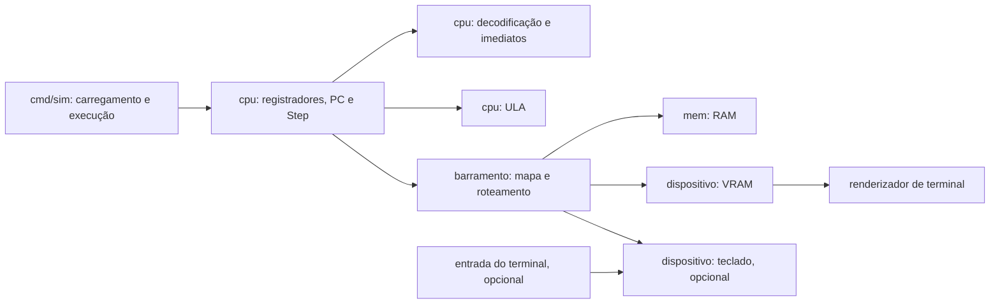

# Design do simulador RISC-V

## 1. Objetivo e escopo

O simulador executa um programa RV32I sobre uma CPU, um barramento e dispositivos mapeados em memória. O projeto já possui parte da ULA, da decodificação e da execução de instruções, incluindo `ANDN`, mas ainda precisa de testes, memória funcional, barramento concreto, programa de demonstração e saída de VRAM.

A implementação deve avançar por etapas. A primeira entrega confiável é um programa pequeno que executa `ANDN`, `LW` e `SW` por meio de CPU, barramento e RAM. A cobertura completa de RV32I e os extras de teclado/interrupção só devem ser declarados concluídos após comparar o escopo do enunciado com as instruções e protocolos implementados.

### Fora das decisões deste documento

O repositório não contém os valores do mapa de memória da semana 4 nem a especificação do teclado/interrupção. Os endereços, tamanhos, dimensões de tela, codificação da VRAM e semântica exata de interrupção devem ser preenchidos a partir do enunciado oficial; não devem ser inferidos ou inventados.

## 2. Arquitetura

A CPU conhece apenas uma interface de acesso ao barramento. O barramento encaminha cada acesso ao dispositivo que possui aquele endereço. RAM, VRAM e teclado implementam o contrato de dispositivo sem depender da CPU.

### Responsabilidades por pacote

- `cpu`: estado arquitetural, decodificação, execução de uma instrução, ULA e tratamento de falhas de execução. Não conhece os tipos concretos de memória ou dispositivos.
- `barramento`: interface de acesso e implementação que mapeia intervalos de endereços para dispositivos. Detecta regiões sobrepostas, acessos sem mapeamento e operações inválidas.
- `mem`: RAM byte-endereçável, limitada à região atribuída pelo mapa oficial. Mantém armazenamento e valida limites/alinhamento conforme o acesso.
- pacote de dispositivos (a definir quando o mapa oficial estiver disponível): VRAM e, opcionalmente, teclado. Cada dispositivo valida os endereços e valores que recebe.
- `cmd/sim`: composição da máquina, carregamento do programa, limite de execução, apresentação do estado final e integração opcional com terminal.

Os nomes e a localização dos pacotes de dispositivos podem seguir a organização final do repositório; o limite de dependência é mais importante que criar pacotes separados sem necessidade.

## 3. Contratos principais

### CPU

A CPU mantém 32 registradores de 32 bits e o `PC`. O registrador `x0` sempre lê como zero e descarta escritas. O estado atual usa um barramento no campo da CPU; esse contrato deve continuar abstrato.

Cada chamada de `Step` executa no máximo uma instrução:

1. Busca a instrução no endereço atual do `PC`.
2. Decodifica opcode, registradores, functs e imediato.
3. Valida se a instrução e a combinação de campos são suportadas.
4. Calcula resultado, endereço de memória ou condição de desvio.
5. Realiza acesso a dispositivo quando necessário.
6. Atualiza registradores e, por último, o `PC`.

A atualização do `PC` deve ocorrer somente depois de uma instrução válida. Instruções inválidas e falhas no barramento devem ser reportadas explicitamente, em vez de parecerem instruções executadas com sucesso. Para operações que possam falhar, evite alterar parte do estado arquitetural antes de confirmar que a operação pode ser concluída.

A API atual `Step()` não retorna erro. Antes de adicionar RAM e dispositivos reais, recomenda-se definir um contrato com erro explícito, por exemplo `Step() error`; a assinatura final deve ser aplicada consistentemente nos testes e no runner. Um `Run(limite)` pode repetir `Step` até alcançar o limite ou uma condição de parada, sem laço ilimitado acidental.

### Acesso ao barramento e dispositivos

O barramento recebe endereços de byte. Cada intervalo mapeado possui um endereço inicial, tamanho e dispositivo proprietário. O barramento valida o intervalo e traduz o endereço para um deslocamento relativo ao dispositivo antes de encaminhar o acesso.

O contrato atual oferece apenas leitura e escrita de 32 bits e não propaga erros. Recomenda-se definir antes da implementação se a entrega exige somente `LW`/`SW` ou o conjunto completo de cargas e armazenamentos RV32I. Se exigir `LB`, `LBU`, `LH`, `LHU`, `SB` e `SH`, o contrato precisa representar larguras de acesso menores que 32 bits; não se deve simular essas operações mascarando erros de tamanho ou alinhamento.

Em qualquer versão do contrato:

- Endereços não mapeados e acessos fora dos limites produzem falha explícita.
- A política de alinhamento é consistente com a ISA e com o enunciado.
- O barramento rejeita intervalos sobrepostos durante a configuração da máquina.
- A RAM e os dispositivos não recebem endereços pertencentes a outra região.

### RAM e mapa de memória

A CPU calcula endereços como endereços de byte. Portanto, a RAM deve traduzir endereços de byte corretamente. Se o escopo incluir acessos subpalavra, use armazenamento byte-endereçável; uma representação somente por palavras só é suficiente se o contrato limitar os acessos a palavras alinhadas.

A tabela abaixo deve ser completada com o enunciado oficial antes da implementação do mapa definitivo:

| Região | Endereço inicial | Tamanho | Permissões/acessos | Responsável |
|---|---:|---:|---|---|
| RAM | A confirmar | A confirmar | Conforme enunciado | `mem.RAM` |
| VRAM | A confirmar | A confirmar | Conforme enunciado | Dispositivo de vídeo |
| Teclado | A confirmar | A confirmar | Conforme enunciado, se aplicável | Dispositivo de entrada |
| Outras regiões | A confirmar | A confirmar | Conforme enunciado | A definir |

A memória de demonstração pode ser simples, mas deve usar o mesmo modelo de endereço e as mesmas regras de erro da implementação definitiva sempre que possível.

## 4. Execução e fluxo de dados

### Instrução aritmética/lógica

`Step` busca a palavra de instrução, a decodificação extrai os operandos, e a ULA calcula o resultado. A CPU escreve em `rd` (exceto `x0`) e avança o `PC` em quatro bytes.

Para `ANDN`, o resultado é `rs1 &^ rs2`: bits definidos em `rs1` permanecem somente quando o bit correspondente de `rs2` é zero. Os testes devem distinguir esse comportamento de `AND`.

### Carga e armazenamento

Para `LW`, a CPU calcula `rs1 + immI`, lê uma palavra do barramento e só então escreve o valor em `rd`. Para `SW`, calcula `rs1 + immS` e grava no barramento o conteúdo do registrador indicado por `rs2`. O código atual usa um índice incorreto para obter o valor de `SW`; essa correção e um teste de execução são pré-requisitos para integrar memória real.

### Desvios

A CPU compara `rs1` e `rs2` conforme `funct3`. Se a condição for verdadeira, define `PC = PC_atual + immB`; caso contrário, usa `PC_atual + 4`. A reconstrução do imediato B deve incluir todos os bits fragmentados, preservar o sinal e manter o alinhamento especificado pela ISA.

### Instruções não suportadas

O código atual cobre apenas parte do conjunto esperado. Deve existir uma lista de instruções requeridas pelo enunciado e uma lista de instruções implementadas. Opcode desconhecido ou combinação inválida de funct deve gerar um resultado de erro definido; não deve avançar o `PC` silenciosamente como se a instrução fosse válida.

## 5. Inicialização e execução do simulador

`cmd/sim` monta os componentes em ordem:

1. Lê ou define as regiões de memória a partir de uma configuração derivada do enunciado.
2. Cria RAM e dispositivos e registra cada região no barramento.
3. Carrega as palavras do programa na memória de instruções, respeitando o endereço de início definido.
4. Cria a CPU com o barramento e inicializa o `PC` para esse endereço.
5. Executa até um limite de instruções, erro ou condição de parada explícita.
6. Exibe resultado verificável: registradores relevantes, valores de memória e, quando implementada, a tela renderizada.

A primeira demonstração deve ser pequena e determinística: calcular um resultado com `ANDN`, armazenar e carregar um valor e exibir os valores esperados. Não depende de interface interativa nem de dispositivos opcionais.

## 6. VRAM e renderização

A VRAM é um dispositivo mapeado no barramento. Sua codificação, dimensões, tamanho e região de endereço vêm do enunciado. A conversão de endereço para célula/pixel pertence ao dispositivo ou a uma função dedicada, não à CPU.

A renderização lê um quadro consistente da VRAM e o converte para saída de terminal. Deve ser possível testar essa conversão sem iniciar uma sessão interativa. A frequência de atualização (por quadro, sob comando ou outra definida pelo projeto) deve ser decidida antes de conectar a renderização ao laço de execução.

## 7. Entrada e interrupção opcionais

O teclado e as interrupções são funcionalidades opcionais, implementadas depois da execução básica e dos testes de integração.

O dispositivo de entrada deve seguir o endereço e protocolo do enunciado. A interface de host pode transformar teclas em eventos, mas a CPU só deve observá-los pelo contrato de dispositivo/interrupção definido para a máquina. O contrato precisa especificar quando interrupções são reconhecidas, que estado é preservado, como a rotina de serviço é iniciada e como a execução normal é retomada. Esses detalhes não são definidos pelo código atual nem pela ISA RV32I básica, então permanecem pendentes até consultar o enunciado.

A captura de terminal, execução da CPU e renderização devem ter responsabilidades separadas. A aplicação precisa encerrar de forma controlada e não pode depender de entrada interativa para executar os testes automatizados.

## 8. Testes e critérios de aceitação

- `cpu`: testes unitários da ULA, campos/imediatos, instruções suportadas, `x0`, `PC`, desvios e erros de instrução/acesso.
- `mem`: limites, alinhamento, endereços de byte, preservação de dados e larguras de acesso exigidas.
- `barramento`: roteamento para cada dispositivo, sobreposição de regiões, limites e endereços não mapeados.
- VRAM: conversão de endereços, limites e renderização de um quadro conhecido.
- integração: programa determinístico usando `ANDN`, desvio, `LW`/`SW` e VRAM, com estado final esperado.
- regressão: `go test ./...` passa; `go run ./cmd/sim` executa a demonstração com saída reproduzível.
- extras: teclado/interrupção têm testes automatizados independentes e validação integrada, sem tornar os testes básicos interativos.

## 9. Ordem recomendada de implementação

1. Corrigir o `SW` e validar os imediatos; adicionar testes para ULA, decodificação e `CPU.Step`.
2. Definir o contrato de erros e o escopo de larguras de acesso exigido.
3. Implementar RAM simples e executar a demonstração `ANDN` + armazenamento/carga.
4. Obter o mapa oficial e implementar o mapa de dispositivos e o roteamento do barramento.
5. Implementar e testar VRAM; conectar a renderização ao runner.
6. Criar o programa de integração e expandir as instruções necessárias, uma por vez.
7. Implementar teclado/interrupção e interface interativa somente se o tempo e o enunciado confirmarem esses extras.
